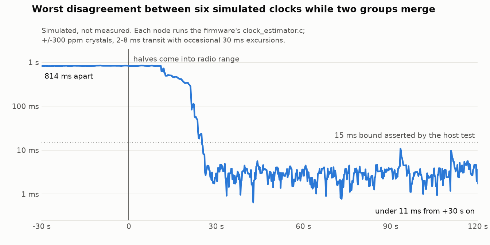

# Leaderless light mesh

Firmware, tools, tests and hardware for small wearable LED rings that keep a
shared clock with no leader. Each ring is an nRF52840 running Zephyr and
OpenThread. Rings gossip their clocks to whoever is in radio range, agree on
who is standing together, and render the same animation on every member of
that group, pixel for pixel, with no ring in charge and nothing streamed.

People walk around. Groups split, merge and lose members all the time, so the
design treats every one of those as a non-event: there is no time master to
elect, lose or fail over.



The chart is a simulation, not a measurement: six nodes, each running the
firmware's own `clock_estimator.c`, in two groups that start 0.8 s apart and
come into range at t = 0. Data and the command that produced it are in
[`docs/data/`](docs/data/). The measured numbers are below.

## What is in here

- **A leaderless clock** in the style of GTSP (Sommer and Wattenhofer, 2009):
  every node keeps `global = h * local + theta`, pulls `theta` (phase) and `h`
  (rate) toward a trust-weighted median of its neighbours, and regresses rate
  on the neighbours' raw, never-adjusted clocks. Design in
  [`TIME-SYNC.md`](TIME-SYNC.md); wire format and policy in
  [`docs/firmware-architecture.md`](docs/firmware-architecture.md).
- **Group formation** from one-hop radio contact, with hysteresis, reciprocal
  topology and a timing gate, so "lit as a group" implies "visibly in sync".
- **Signed over-the-air updates** through MCUboot with automatic rollback, a
  transactional deployer, and a boot-recovery ladder that gets a hung node
  back to a USB drive without a button.
- **A carrier PCB** (KiCad) and **printed enclosures** (FreeCAD).
- **Fleet tools** that run on a Raspberry Pi border router.
- **Host tests and simulators** that compile the same C files the firmware
  ships.

## What was demonstrated, with numbers

Each number names the file that supports it. "Development repository" means
the private repository this was exported from; its history and its real
device inventory are not included here.

| | Number | Source |
|---|---|---|
| Sync measured optically, two rings | 301 paired LED flashes over five minutes at 30 fps: **3.59 ms** median offset, 3.11 ms MAD, -0.93 ms/min drift. A later run: 304 pairs, 4.42 ms, 3.35 ms MAD, +0.65 ms/min | `docs/development-plan.md`, "Execution log — 2026-07-21", Phase 6 |
| Same two rings before the sync engine existed | 47.8 ms apart (arbitrary phase) | `TIME-SYNC.md`, "Baseline measurement" |
| Recovery from a forced clock scramble, on camera | back in step 9.9 s after the scramble, 150 flash pairs | `evidence/hardware/2026-07-20/sync-tests/20260718-044700-scramble/result.json` |
| Fleet | 39 rings inventoried when the fleet was deployed (41 by the last commit); 24 is the designed cap for one group | development repository inventory (a 6-row sample is in `config/rings.json`); cap in `docs/firmware-architecture.md` |
| Largest group qualified on hardware | six rings re-forming one scene after a rollout; one deliberately scrambled ring was demoted in 24 s and readmitted 16 s after the abuse stopped | `docs/sync-cohesion-investigation.md`, "Live fleet qualification" |
| Largest group in simulation | 24 nodes cold-starting together converge in 29-36 s | `docs/gap-hunt-2026-08.md`, section 3 |
| Releases | 41 tagged releases, v0.1.16 to v0.1.93, over 268 commits from 2026-07-17 | development repository; process in `docs/releases.md` |
| Reproducible builds | two pristine builds byte-identical except the RSA-PSS signature salt | `docs/releases.md` |
| Fleet image size | 288,304 of 372,736 bytes flash (77.35%) at v0.1.16; the release gate is 92% | `docs/releases.md`, `scripts/check_firmware_size.py` |
| Reboot soak | 124 reboot trials archived, 121 passed, including 50/50 and 43/43 runs | `evidence/hardware/SUMMARY.md` |
| Forced rollback | final run 5/5: an image that refuses to confirm is reverted by MCUboot, in 119.86-120.63 s. Two earlier harness runs failed on their first trial and are kept | `evidence/hardware/SUMMARY.md`, `docs/development-plan.md` Phase 1 |
| USB/UF2 recovery | 36/36 trials | `evidence/hardware/SUMMARY.md` |
| OTA transactions | 28 per-device results archived: 12 `success`, 10 `already_current`, 5 `upload_failed` (uploads cut on purpose; none armed), 1 `rollback` (an image on an isolated partition that must not confirm) | `evidence/hardware/SUMMARY.md` |
| Recovery ladder | a deliberately hanging image presented itself as a USB drive 51 s after reset; the board was healthy 5.7 s after the file copy | `docs/boot-recovery-ladder.md` |
| Host tests | 212 Python tests; they build and run 22 C suites (131 test functions) against the firmware sources | `tests/`, run below |
| Simulators | 9 measurement harnesses (7 protocol, 2 rendering) plus the merge trace | `tests/c/campaign/`, `tests/c/bench/`, `tests/c/merge_trace.c` |

The archived evidence covers 2026-07-18 to 2026-07-20 and two rings. Later
results in the table are from the written record; their raw files stayed on
the gateway.

## What went wrong

- **A release was withdrawn.** v0.1.82 passed review and host tests, then
  wedged every board into its watchdog seconds after joining a live mesh: a
  struct had grown past the 4 KB main stack. v0.1.83 fixed it. The only
  "healthy" bench run of v0.1.82 had been on a quieted mesh that never
  exercised the path. `docs/gap-hunt-2026-08.md`, 2026-08-17 addendum.
- **The Rev A board has a pin-count error.** The module has 13 pins per side;
  the carrier was laid out for 12. Seated the obvious way it shorts RAW to
  ground. The battery connector is also routed to the wrong rail and must not
  be used. `docs/hardware-rev-a-errata.md`.
- **The "white flash" was a brownout.** A scene that lit every LED at once
  drew about six times the idle load for 370 ms, sagged the rail and turned
  the ring white. It looked like a colour bug and was invisible in any
  pixel-level simulation. The fix is a per-frame power budget found on the
  hardware (45 per LED); the first value tried (90) never engaged.
  `firmware/thread-ring/src/led_budget.h`, `tests/c/led_budget_test.c`.
- **A weighted mean let one liar capture the clock.** In simulation a crowd
  converged onto a node broadcasting a constant 10 s lie. The estimator now
  uses a weighted median, a snap quorum and minority-outlier rejection.
  `docs/sync-cohesion-investigation.md`.
- **A median tie-break ratcheted the fleet's rate trim** about +300 ppm per
  minute while phase stayed locked, so nothing looked wrong. Found in
  telemetry on seven live rings, reproduced in the simulator, fixed in
  v0.1.76 and kept as a regression test. Same document.
- **Still open.** An intermittent watchdog reset during the MCUboot image
  swap (`reset=00000012`) was never fixed; the node rolls back safely but the
  update does not land (`docs/onboarding-blank-boards.md`, "Failure
  signatures"). The battery-park branch of the recovery ladder was never
  qualified on hardware. Battery voltage cannot be read on Rev A.

## Limits of the evidence

- The camera measurement is of **two** rings on a bench. Larger groups were
  checked through firmware telemetry and by eye, not optically.
- Everything about 24-node behaviour is simulated.
- The simulators model the radio as per-link loss and jitter. They do not
  model 802.15.4 contention or body shadowing.
- The measurement harnesses in `tests/c/campaign/` assert nothing, and the
  engine has changed since `docs/gap-hunt-2026-08.md` was written, so their
  output today does not reproduce every figure in that report.
- The firmware in this export was **not built** as part of preparing it: the
  Thread credentials were replaced with placeholders, and a log string and a
  few comments were reworded. The host tests were run (below).

## Build, run, test

Host tests need Python 3.12 or newer and a C compiler (`cc`). No hardware, no
network.

```sh
uv run --no-project python -m unittest discover -s tests
```

212 tests; a few seconds. The simulators that print measurements:

```sh
SRC=firmware/thread-ring/src
cc -std=c11 -O2 -I$SRC -Itests/c -Itests/c/campaign \
   $SRC/group_engine.c $SRC/group_policy.c $SRC/social_scene.c \
   $SRC/peer_slot_policy.c $SRC/sync_schedule.c $SRC/clock_estimator.c \
   tests/c/campaign/integrated.c -lm -o /tmp/integrated && /tmp/integrated

cc -std=c11 -O2 -I$SRC -Itests/c $SRC/clock_estimator.c \
   tests/c/merge_trace.c -lm -o /tmp/merge_trace && /tmp/merge_trace | head
```

See `tests/c/campaign/README.md` and `tests/c/bench/README.md` for the rest.

Firmware needs Zephyr SDK 0.17.0 and the pinned workspace
(`west.yml`, `config/toolchain.lock.json`, `docs/releases.md`):

```sh
ZEPHYR_WORKSPACE=/path/to/zephyr-ws scripts/bootstrap_workspace.sh
scripts/build_firmware.sh debug
MCUBOOT_SIGNING_KEY=/secure/key.pem scripts/build_firmware.sh fleet
scripts/local_ci.sh        # the whole gate, including the native_sim test
```

Target board: a SuperMini nRF52840 (nice!nano-compatible) with the Adafruit
UF2 bootloader, Zephyr board `promicro_nrf52840/nrf52840/uf2`. Zephyr,
MCUboot, OpenThread and the UF2 bootloader are not vendored; `west` fetches
the first three.

### Network credentials

`firmware/thread-ring/prj.conf` carries **placeholder** Thread credentials:
the well-known example network key, PAN ID 0xABCD and Zephyr's default
extended PAN ID. A ring built with them will only join a network that uses
the same public values, which you should not run.

To use your own, change `CONFIG_OPENTHREAD_NETWORKKEY`, `CONFIG_OPENTHREAD_PANID`
and `CONFIG_OPENTHREAD_XPANID` (and the channel and name if you like) to match
your border router's active dataset. Keep the real values out of version
control: either edit `prj.conf` locally, or put the three lines in a private
Kconfig fragment and add it to the `EXTRA_CONF_FILE` list in
`scripts/build_firmware.sh`. The network key is the trust boundary between
rings, so treat it like a password.

### Other things you supply

- `config/rings.json` is a six-row sample with invented serial numbers and
  addresses. The fleet tools resolve every target through this file; replace
  it with your own devices.
- `config/release-signers.example` shows the allowed-signers format for
  release attestation. Copy it to `config/release-signers` with your own key.
- Firmware and release signing keys, and the per-device control keys, are
  never in the repository. `docs/security.md` describes where they live.
- The fleet tools expect a small dashboard service on the gateway
  (`http://localhost:8080`) for name lookup and heartbeat history. It belongs
  to a separate project and is not included; most tools also accept an IPv6
  address directly.

## Layout

| Path | Contents |
|---|---|
| `TIME-SYNC.md` | Protocol design notes |
| `docs/` | Architecture, release process, security model, errata, investigations. Index in `docs/README.md` |
| `firmware/thread-ring/` | The ring firmware (about 11,500 lines of C). Policy modules are pure C with no Zephyr dependencies |
| `firmware/ring-test/`, `firmware/settings-medic/` | Bring-up image and a settings-partition recovery image |
| `tests/` | Python tests; `tests/c/` C suites and simulators; `tests/zephyr/` native_sim boot/OTA test |
| `pi-tools/` | Fleet tools for the gateway: transactional deploy, control client, HIL harnesses, camera timing |
| `scripts/` | Build, release, signing, CI, workspace checks, USB helpers |
| `config/` | Sample inventory, HIL job definitions, toolchain lock |
| `patches/` | Tracked patches to MCUboot and Zephyr |
| `deploy/systemd/` | Sandboxed units for the HIL runner |
| `hardware/` | KiCad project, gerbers, BOM/CPL, renders |
| `enclosure/` | Printed enclosures and diffuser caps |
| `evidence/` | Archived hardware test results and a summary table |

## Not included, and why

- Git history and release binaries: the export is a snapshot of `main`.
- The real device inventory, control keys, signing keys and Thread
  credentials.
- Kernel logs and raw captures from the gateway (host output).
- Session handoff notes and one-off rollout scripts from the development
  repository.
- The gateway's operating-system setup and dashboard, which belong to a
  separate project.
- The two browser simulations the design was first worked out in.

## Licence

Code, tests, tools and documentation: MIT, see [`LICENSE`](LICENSE).
Hardware and enclosure design files: CC BY 4.0, see
[`LICENSE-hardware.md`](LICENSE-hardware.md). `patches/` modify Apache-2.0
projects and stay under that licence.

Copyright 2026 Eamon White <white.eamon@gmail.com>
