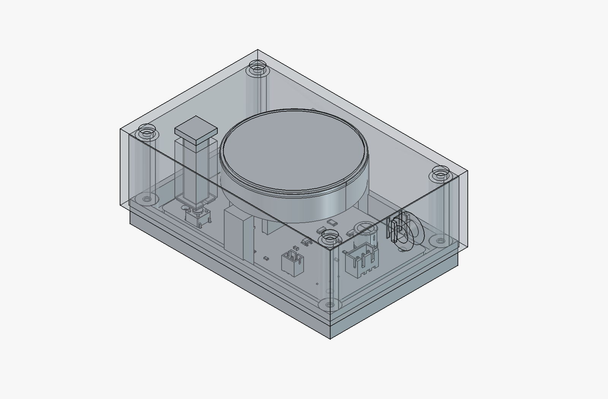

# Enclosures and diffuser caps

The printed parts for the light: a 45 mm ring of 16 addressable LEDs points up
into a translucent printed cap, inside a printed enclosure. Everything here is
FDM-printed PLA. Design files are CC BY 4.0 (see `../LICENSE-hardware.md`).

| Folder | Contents |
| --- | --- |
| [`node-enclosure/`](node-enclosure/) | Enclosure for the carrier PCB in `../hardware/`: ~94 x 60 mm, base + roof + captive button kit. STL, STEP, FreeCAD source, renders, and the generator/validator scripts. |
| [`ring-puck/`](ring-puck/) | The small one: 54 x 54 x 23.4 mm, two printed parts, LED ring plus a directly wired module, no carrier board. STL, STEP, FreeCAD source. |
| [`diffuser-caps/`](diffuser-caps/) | 34 diffuser patterns as SVG, the contact sheet, a predicted-motion ranking, and one reference cap STL. Read its README for the design rules. |
| [`photos/`](photos/) | One photo: printed caps on the build plate. |
| [`key-dimensions.md`](key-dimensions.md) | The numbers everything is built on (ring, cap, module, USB opening). |
| [`making-it-physical.md`](making-it-physical.md) | Print recipes and what went wrong before they were settled. |

## Node enclosure

Built around the 80 x 46 mm carrier board, closed by 4 x M2.5 x 35 mm screws.

- Close-fitting USB-C opening. It is deliberately asymmetric: nearly all the
  clearance is above the board. An earlier centred opening let the moulded
  shoulder of an ordinary USB-C plug catch the top edge.
- A captive square push-button actuator: a separate printed part that drops in
  from outside and is held by a snap-on collar inside (`user-button-kit.stl`).
- A D-ring loop on the short side so the unit can hang.
- The cap and LED ring sit in the raised roof on integrated shelves.

`cad-scripts/create_clamped_v5.py` generates this model in FreeCAD and
`cad-scripts/validate_clamped_v5.py` checks it numerically (collisions,
button travel, print envelope). They are included to show how the model is
built and checked; they are the last step of a chain and expect the previous
revision's FreeCAD document, which is not shipped. `node-enclosure.FCStd` is
the complete, editable result.

Status: printed, fits. Plug clearance and the button's return action were
not fully re-checked on the final revision.

## Ring puck

A rounded square in two screw-together parts (4 x M2 self-tapping from the
top). The module presses into the base; the LED ring sits on a 1 mm lip with
its wires dropping straight down a 42 mm hole; the top ring clamps the cap.
The inside of the base is a 45-degree funnel so it prints without bridging.

Status: printed and assembled several times.

## What is not here

- The uncropped printer-camera photos (they show a room, not the parts).
- The two full print-plate STLs of cap sets (about 9 MB of mesh); the single
  reference cap and the pattern SVGs carry the same information.
- The parametric cap generator and the earlier enclosure revisions.
