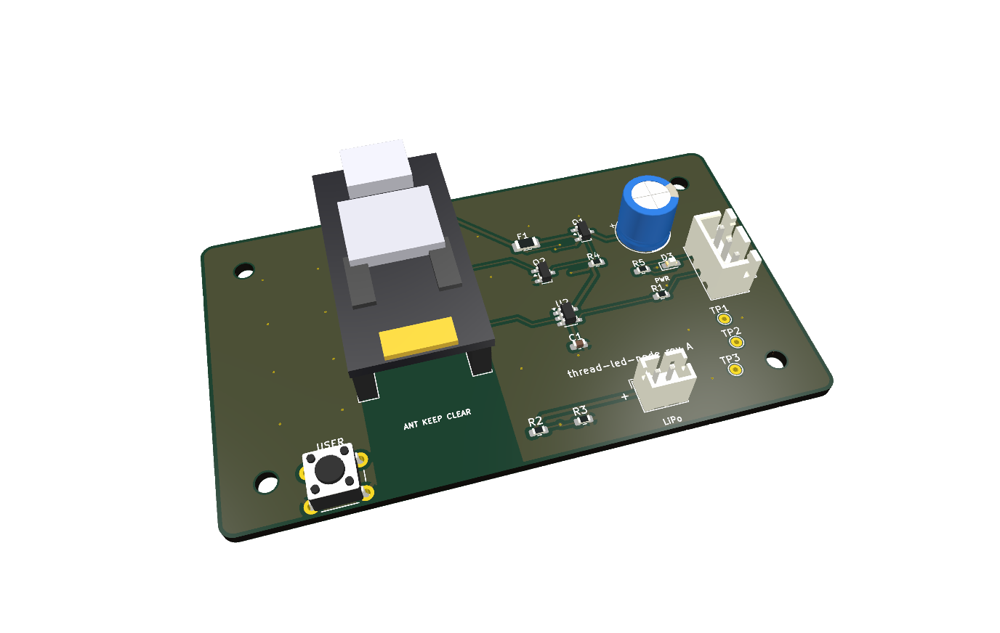

# Carrier PCB (Rev A)

KiCad 10 project for an 80 x 46 mm, 2-layer carrier that takes a SuperMini
nRF52840 module (a nice!nano-style "Pro Micro nRF52840" clone) and drives an
external WS2812B ring or strip. Design files are CC BY 4.0
(`../LICENSE-hardware.md`).

> **Rev A has two known errors. Read `../docs/hardware-rev-a-errata.md` before
> building one.**
>
> 1. The module has 13 positions per side (separate B-/B+ pins at the USB
>    end); the carrier was laid out with 12-position sockets. Seat the module
>    with B-/B+ hanging outside the sockets. Seating them in the sockets shifts
>    every pin by one and shorts RAW to ground.
> 2. J2+ is routed to RAW rather than the module's B+ charger terminal. Do not
>    connect a rechargeable battery to J2. USB and current-limited bench power
>    are verified; battery operation is not safe on Rev A.
>
> The silkscreen pin labels also print partly off the board edge.

## Files

| Path | Contents |
|---|---|
| `thread-led-node.kicad_sch`, `.kicad_pcb`, `.kicad_pro` | Schematic, board, project |
| `gerbers/` | Gerbers and Excellon drill files as sent to the fab |
| `assembly/` | BOM and placement (CPL) files for JLCPCB assembly |
| `fab_export.py` | Regenerates the fab package; computes placement centroids from pad bounding boxes and applies per-footprint rotation offsets (why: see `../docs/kicad-notes.md`) |
| `models/supermini_nrf52840.wrl` | Generated box-model stand-in for the module, used for the 3D render |
| `renders/` | 3D render, top view (PNG and SVG) |
| `thread-led-node.kicad_pcb.drc.json` | KiCad DRC report: 0 errors, 5 warnings (silkscreen), 0 unconnected |

`fab_export.py` needs KiCad's `pcbnew` Python module and `kicad-cli`. Footprints
and 3D models come from the stock KiCad libraries, which are not redistributed
here.

## Power path

- RAW -> F1 (1.1 A polyfuse) -> Q1 (AO3401A high-side switch, driven by Q2
  2N7002 with a 100 k pull-up, off at boot) -> J1 (JST-XH) to the LEDs.
- U2 (SN74LV1T34) level-shifts LED data and is powered from the fused,
  unswitched rail.
- Firmware must drive `EN_LED` (P0.17) high before the LED rail is live, wait
  for it to settle, and send black before turning it off.

## Pin map (SuperMini / nice!nano numbering)

| Signal | Pin | Board net |
|---|---|---|
| LED data out | P0.06 (J3-1) | LED_DATA_MCU -> U2 -> 330 ohm -> J1-2 |
| LED power enable | P0.17 (J3-5) | EN_LED (high = strip on) |
| USER button | P0.20 (J3-6) | BTN (to GND, internal pull-up) |
| Battery sense | P0.31 / AIN7 (J4-5) | VBAT_DIV. Measured floating on the tested modules: see the errata |

## Layout notes

- Sockets are placed so the module's USB-C face sits flush with the top board
  edge, for an enclosure wall.
- Copper pours on both layers are windowed out under the module's chip
  antenna.
- TP1 = VLED, TP2 = DIN, TP3 = GND. D3 lights when the LED rail is switched on.
- 4 x M2.5 mounting holes on a 68 x 34 mm pattern.

## BOM

| Ref | Part | LCSC |
|---|---|---|
| U2 | SN74LV1T34DBVR, SOT-23-5 | C100024 |
| Q1 | AO3401A P-FET, SOT-23 | C15127 |
| Q2 | 2N7002, SOT-23 | C8545 |
| F1 | 1206L110THYR polyfuse 1.1 A | C126818 |
| J1 | JST B3B-XH-A 3-pin | C144394 |
| J2 | JST-PH 2-pin | C126363 |
| J3, J4 | 1x12 2.54 mm female header | C7509522 |
| C1 | 100 nF 0603 | C14663 |
| C2 | 470 uF 16 V radial | C105296 |
| R1 | 330 ohm 0603 | C23138 |
| R2, R3 | 1 M 0603 | C22935 |
| R4 | 100 k 0603 | C25803 |
| R5 | 1 k 0603 | C21190 |
| D3 | red LED 0603 | C2286 |
| SW1 | 6x6 mm THT tactile | C42416242 |

Recorded cost for five assembled boards: PCB $2 + assembly $28.52, before
shipping (`../docs/kicad-notes.md`).
